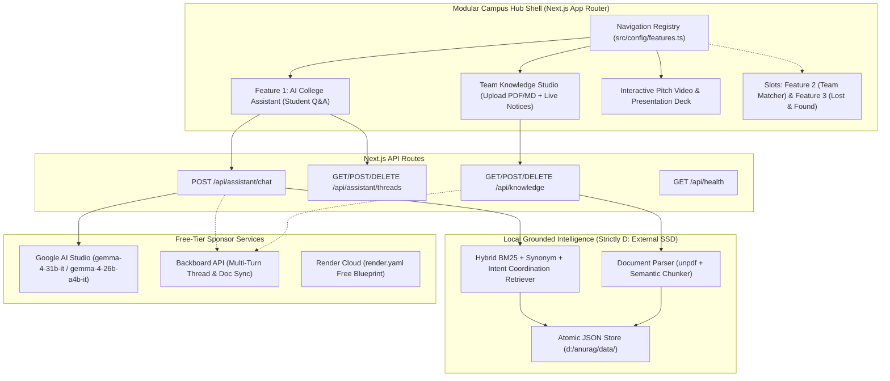

# 🎓 Modular Campus Hub — Feature 1: AI College Assistant
### Hacktoberfest Hack Day Jaunpur (at Prasad Institute of Technology)

[](https://opensource.org/licenses/MIT)
[-indigo.svg)](https://ai.google.dev/)
[]()
[-blue.svg)]()
[](https://app.backboard.io/)
[](https://render.com/)

> **Built for Hacktoberfest Hack Day Jaunpur • 24 October 2026**  
> *Venue: Seminar Hall & Computer Center, Block B, Prasad Institute of Technology (PIT), Jaunpur, Uttar Pradesh.*  
> 👉 **Handing off this project? Read [HANDOFF_GUIDE.md](HANDOFF_GUIDE.md) for 1-click setup, API key entry, and the 3-minute judge pitch script!**

---

## 📌 Executive Summary

**Modular Campus Hub** is a modular, extensible collegiate web application built to eliminate information chaos during high-stakes hackathons and campus life.

Our flagship module—**Feature 1: AI College Assistant**—enables students, hackers, and organizers to ask natural-language inquiries such as:
- ⚡ *"When is the next hackathon?"*
- 👥 *"How do I join a project team?"*
- 🔍 *"Where do I report a lost item?"*

Every response is **100% grounded** in official documents and circulars uploaded by the campus team using **Google Gemma 4** (`gemma-4-31b-it` / `gemma-4-26b-a4b-it`) and a pure TypeScript **Hybrid BM25 + Semantic Grounded Retriever**. If an inquiry falls outside campus records (e.g. *"Does the campus have an Olympic swimming pool?"*), the assistant **defensively refuses to hallucinate**, citing verified policy and directing the student to the Student Welfare Desk.

---

## 🏆 Hackathon Sponsor Track Alignment ($0 Cost Stack)

Every component of Modular Campus Hub runs at **$0 cost with zero credit card requirements**:

| Sponsor Challenge Track | Integration Details | Free-Tier Status |
| :--- | :--- | :--- |
| **Google Gemma Challenge (MLH)** | Powers grounded campus Q&A using **Google Gemma 4** (`gemma-4-31b-it` with automatic fallback to `gemma-4-26b-a4b-it`) via Google AI Studio (`@google/genai`). Employs a strict system grounding prompt, inline source citations (`[Source: <Title>]`), and an interactive **"Inspect Grounded Evidence"** drawer. | **$0 / month** (Google AI Studio Free Tier) |
| **Best Open-Source AI Project (MLH)** | Modular Next.js 15 TypeScript architecture, MIT `LICENSE`, clean separation of concerns (SOLID principles), comprehensive `.env.example`, and **33/33 passing automated tests** in Vitest. | **100% Open-Source (MIT)** |
| **Best Use of Backboard (DEV Track)** | Seamlessly synchronizes persistent multi-turn chat threads (`remoteThreadId`) and indexes campus knowledge documents with **Backboard REST API** (`https://app.backboard.io/api`). Automatically falls back to local atomic JSON persistence if `BACKBOARD_API_KEY` is omitted. | **$5 Free Credit** (Hacktoberfest Sponsor Perk, No CC) |
| **Best Use of Render (DEV Track)** | Ships with a turnkey `render.yaml` blueprint (`plan: free`) and a `/api/health` status route for instant 1-click cloud deployment with live public URLs. | **$0 / month** (Render Free Web Service) |

---

## 🏗️ System Architecture



### Strict External SSD Isolation Guarantee
To preserve host system cleanliness, all npm package caches (`d:/anurag/.cache/npm`), build temporaries (`d:/anurag/.cache/tmp`), node_modules, and persistent data (`d:/anurag/data/`) are confined strictly to `D:`. Next.js telemetry is disabled (`NEXT_TELEMETRY_DISABLED=1`), ensuring **zero writes to the host `C:` drive**.

---

## ✨ Key Capabilities

### 1. Flagship Feature 1: AI College Assistant
- **Pre-Seeded Ground Truth**: Pre-loaded with official details for **Hacktoberfest Hack Day Jaunpur 2026**, project team formation rules (1 to 4 members, Discord matchmaking), campus Lost & Found protocol (Student Welfare Desk in Block A), and campus facilities.
- **One-Click Quick Starter Prompts**:
  1. ⚡ *"When is the next hackathon?"*
  2. 👥 *"How do I join a project team?"*
  3. 🔍 *"Where do I report a lost item?"*
  4. 🛡️ *"Does the campus have an Olympic swimming pool?"* (Verifies zero-hallucination refusal)
- **Interactive Citations & Evidence Drawer**: Every answer provides clickable source tags. Judges can expand the *"Inspect Grounded Evidence"* drawer to inspect chunk similarity scores and matching tokens.
- **Persistent Chat History**: Supports multi-turn conversations stored locally in atomic JSON and optionally synced to Backboard.

### 2. Team Knowledge Studio
- **Passcode Protected**: Unlocks with `TEAM_PASSCODE` (default `pit2026`, featuring a 1-click Demo Unlock button for judges).
- **Universal Document Ingestion**: Upload `.pdf`, `.md`, or `.txt` college circulars. Text is extracted via `unpdf` and partitioned into semantic overlapping chunks.
- **Instant Notice Composer**: Publish live notices (e.g. *"Free Midnight Pizza in Lab 3 at 1:30 PM"*). The assistant immediately answers questions about newly posted notices within seconds.
- **Dynamic Deletion**: Remove obsolete circulars to verify that old knowledge is pruned instantly from RAG search.

### 3. Interactive Pitch Video & Presentation Deck (`/pitch`)
- **Video Presentation Player**: Features full playback controls (Play, Pause, Previous, Next), slide scrubber, speed selectors (1x, 1.25x, 1.5x), slide thumbnails, and **browser speech synthesis narration** that speaks the pitch script aloud in real time.
- **WebM Video Export & Download**: Includes a built-in Canvas 1280x720 video encoder. Clicking **"Download Pitch Video (.webm)"** renders each pitch slide with branded gradients, typography, and badges into an HTML5 canvas stream, records it via `MediaRecorder`, and automatically triggers a local video file download (`modular-campus-hub-pitch.webm`).
- **Synchronized Transcript Drawer**: Displays the word-for-word voiceover script for judges alongside slide metadata.
- **Fullscreen Mode**: Toggle high-impact fullscreen presentation mode with a single click.

### 4. Modular Feature Registry (`src/config/features.ts`)
- Features registered extension slots for upcoming hackathon deliverables:
  - **Feature 2 Slot**: Smart Project Team Matcher (`/teams`)
  - **Feature 3 Slot**: Digital Lost & Found Recovery Board (`/lost-found`)

---

## 🧪 Automated Verification Suite

All **33 tests run in Vitest** with zero mocks for local search, proving real mathematical BM25 retrieval, self-healing storage, and Next.js API route lifecycle:

```powershell
$env:npm_config_cache="d:\anurag\.cache\npm"; $env:TEMP="d:\anurag\.cache\tmp"; $env:TMP="d:\anurag\.cache\tmp"; npm test
```

### Test Suite Summary (33 / 33 Passed)
- ✅ `tests/retriever.test.ts` (6 tests):
  - Retrieves Hacktoberfest details for *"When is the next hackathon?"*
  - Retrieves team formation protocol for *"How do I join a project team?"*
  - Retrieves Lost & Found protocol for *"Where do I report a lost item?"*
  - Matches domain synonyms for *"misplaced my wallet"* $\rightarrow$ Lost & Found
  - Matches domain synonyms for *"squad partner"* $\rightarrow$ Project Teams
  - Safely rejects out-of-domain queries (*"swimming pool and scuba diving"*) with 0 false-positive results.
- ✅ `tests/variations.test.ts` (10 tests — Real-World Student Queries):
  - *"What should I do if I lose my phone?"* $\rightarrow$ correctly routes to Lost & Found (not Project Teams)
  - *"Where is lunch served?"* $\rightarrow$ routes to Hacktoberfest schedule
  - *"Can I participate alone without teammates?"* $\rightarrow$ routes to Project Teams
  - *"What are the Wi-Fi credentials?"* $\rightarrow$ routes to Campus Facilities & Wi-Fi
  - *"When does the library close?"* $\rightarrow$ routes to Campus Facilities & Library
  - *"What is the team size limit?"* $\rightarrow$ routes to Project Teams (1 to 4 members)
  - *"Where can I submit a found item?"* $\rightarrow$ routes to Lost & Found
  - *"Who can I contact if I lose my ID card?"* $\rightarrow$ routes to Lost & Found
  - *"What is the Wi-Fi network SSID?"* $\rightarrow$ routes to Facilities (`PIT-Student-Secure`)
  - *"Can solo participants join the hackathon?"* $\rightarrow$ routes to Project Teams / Hackathons
- ✅ `tests/api.test.ts` (9 tests — Backend API Lifecycle):
  - `GET /api/health`: Verifies healthy status and `D:` external SSD storage isolation
  - `POST /api/assistant/chat`: Verifies HTTP 400 rejection on empty queries
  - `POST /api/assistant/chat`: Verifies 200 with citations for *"When is the next hackathon?"*
  - `POST /api/assistant/chat`: Verifies zero-hallucination refusal for out-of-domain queries
  - `POST /api/knowledge`: Verifies HTTP 401 unauthorized rejection without passcode
  - `POST & DELETE /api/knowledge`: Verifies publishing live notices with passcode `pit2026`, verifies chat immediately answers using new notice, and verifies deletion
  - `GET/POST/DELETE /api/assistant/threads`: Verifies persistent multi-turn thread lifecycle
  - `GET /api/settings/key`: Verifies API key configuration status reporting
  - `POST /api/settings/key`: Verifies in-app API key verification and persistent saving to `.env.local`
- ✅ `tests/grounding.test.ts` (2 tests):
  - Grounded answer generation with inline source citations
  - Defensive refusal when zero chunks match the inquiry
- ✅ `tests/parser.test.ts` (3 tests):
  - Cohesive chunking for short circulars
  - Semantic heading-based section splits for long multi-part handbooks
  - Safe handling of empty or whitespace inputs
- ✅ `tests/store.test.ts` (3 tests):
  - Automatic seed initialization and self-healing chunks synchronization
  - Atomic JSON document creation, chunking, and deletion
  - Knowledge stats reporting

---

## 🚀 Quickstart Guide

### 1. Prerequisites
- [Node.js](https://nodejs.org/) v18+ (Node v24 tested)
- npm v10+

### 2. Installation
```powershell
# Set D: drive cache isolation (protects C: drive)
$env:npm_config_cache="d:\anurag\.cache\npm"
$env:TEMP="d:\anurag\.cache\tmp"
$env:TMP="d:\anurag\.cache\tmp"
$env:NEXT_TELEMETRY_DISABLED="1"

npm install
```

### 3. Environment Setup
Copy the example environment file:
```powershell
Copy-Item .env.example .env.local
```

| Key | Description | Default / Free URL |
| :--- | :--- | :--- |
| `GEMINI_API_KEY` | Google AI Studio free tier key | Get free key at [aistudio.google.com](https://aistudio.google.com/). *(Optional: App has built-in zero-key Local Grounded Preview mode)* |
| `BACKBOARD_API_KEY` | Backboard API key | Get free $5 credits at [app.backboard.io](https://app.backboard.io/). *(Optional: Defaults to local JSON thread store)* |
| `TEAM_PASSCODE` | Passcode for Team Knowledge Studio | `pit2026` |
| `DATA_DIR` | Local storage directory | `./data` (Strictly on D: drive) |

### 4. Running the Development Server
```powershell
npm run dev
```
Open **[http://localhost:3000](http://localhost:3000)** in your browser.

### 5. Running the Automated Tests
```powershell
npm test
```

### 6. Production Build
```powershell
npm run build
npm start
```

---

## 🌐 1-Click Cloud Deployment to Render

This repository includes a production-ready `render.yaml` blueprint:

1. Push your repository to GitHub.
2. Sign in to [Render](https://dashboard.render.com/) (100% free account).
3. Click **New +** $\rightarrow$ **Blueprint** $\rightarrow$ Connect your repository.
4. Render will automatically detect `render.yaml`, configure the free plan, and deploy your live URL.
5. In the Render Dashboard, add your free `GEMINI_API_KEY` under Environment Variables.

---

## 📋 Step-by-Step Judge Demo Script

1. **Test Core Grounded Answering**:
   - Open `/assistant`. Click on *"When is the next hackathon?"*.
   - Observe the response citing **Hacktoberfest Hack Day Jaunpur 2026** (24 October 2026, 9:30 AM to 3:00 PM at Prasad Institute of Technology, Seminar Hall Block B).
   - Click the citation pill to inspect the exact source chunk and match score.
2. **Test Defensive Refusal (Zero Hallucination)**:
   - Click *"Does the campus have an Olympic swimming pool?"*.
   - Notice the assistant explicitly declines to make up facts, confirms no record exists, and refers the student to the Student Welfare Desk.
3. **Test Dynamic Knowledge Lifecycle**:
   - Navigate to `/knowledge`. Click **"1-Click Judge Demo Unlock (pit2026)"**.
   - Switch to **Quick Notice Composer**.
   - Enter Title: *"Emergency Wi-Fi Maintenance"* and Content: *"Wi-Fi will restart at 2:00 PM for 5 minutes in Block B."*
   - Click **Publish Notice Live**.
   - Return to `/assistant` and ask *"When will Wi-Fi restart?"*.
   - The AI Assistant immediately answers using your newly published notice!
4. **Experience the Pitch Video Presentation**:
   - Navigate to `/pitch`.
   - Click **Play Video Presentation**.
   - Listen to the browser speech synthesizer narrate the project walkthrough while slides scrub forward!

---

## 📄 License

This project is licensed under the [MIT License](LICENSE) — free for educational and commercial use.

Developed with ❤️ for **Prasad Institute of Technology, Jaunpur** & **Hacktoberfest 2026**.
